#   Capstone Project Bash Scripting for Multiplication Table 

## Readme URL Below: 

https://github.com/Agbedeyisegun/3mtt-project/blob/main/darey.io/MarketPeak_Ecommerce/README.md

## Below are the screenshots of the steps.

- Step 1 
Screenshot of terminal showing creation of the project directory called aws_git_linux-capstone-project and MarketPeak_Ecommerce, git initialisation, git branch and status respectively with the cmd below "mkdir", "git init", "git branch" and "git status".
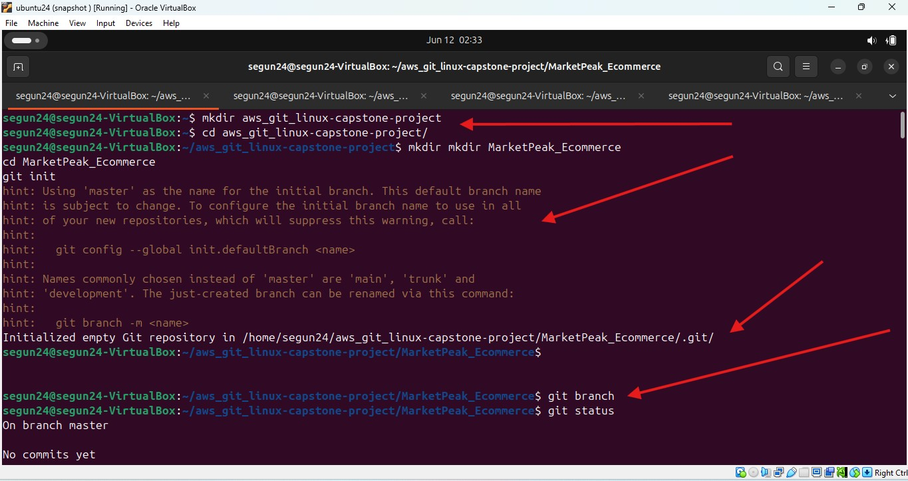

- Step 2 
Screenshot of terminal showing the unzipping of a website template file named 2114_pixie.zip into the project directory aws_git_linux-capstone-project using the command:
unzip ~/Downloads/2114_pixie.zip -d ~/aws_git_linux-capstone-project/.
The terminal displays the extraction process including creation of directories and inflating of HTML, CSS, and font files.
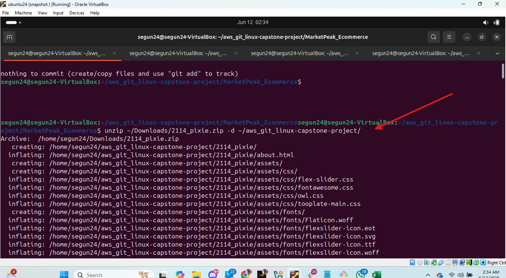

- Step 3 

Screenshot of terminal showing navigation and organization of project files using Linux commands. The user checks current directory with pwd, lists files using ls, creates and removes a mistaken directory (mkdir/), and finally moves the extracted folder 2114_pixie into the MarketPeak_Ecommerce directory using:
mv 2114_pixie/ MarketPeak_Ecommerce/.
Also includes command to display the directory tree: tree -L2 2114_pixie/.
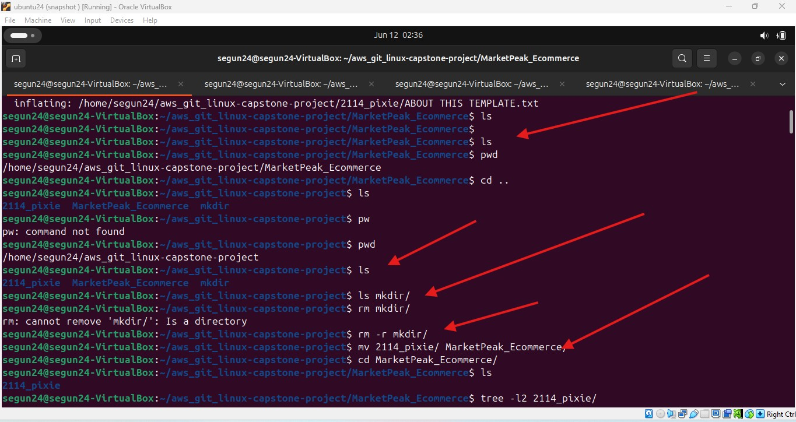

- Step 4

Screenshot of terminal showing the user opening a webpage file with vim 2114_pixie/index.html to inspect or edit its contents. Afterward, the 2114_pixie folder is renamed to marketpeak_Ecommerce using the command:
mv 2114_pixie/ marketpeak_Ecommerce.
Directory contents are checked before and after the rename with ls.
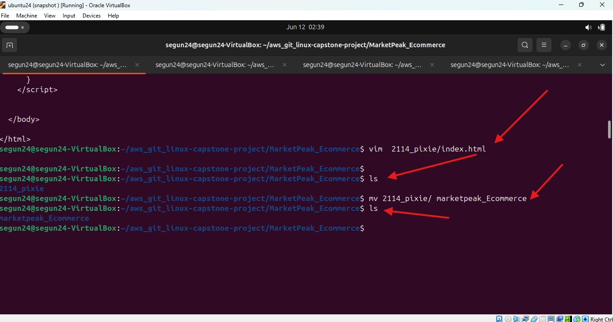

- Step 5

Screenshot of terminal showing the user inside the `MarketPeak_Ecommerce` directory. The user checks the present working directory with `pwd`, stages all files using `git add .`, sets Git global configuration for username and email, and commits the staged files with a message:  
`"Initial commit with basic e-commerce site structure"`.

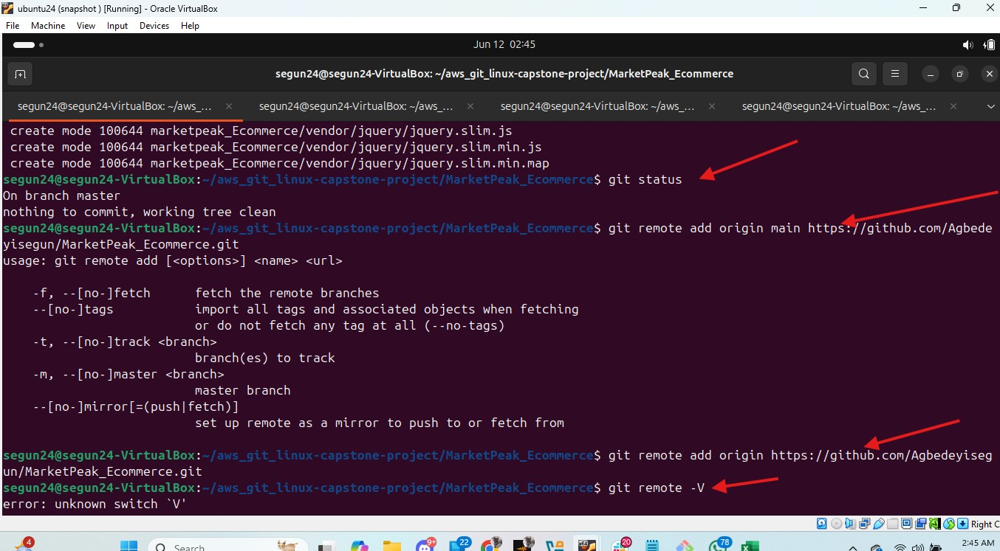

- Step 6

Screenshot of terminal showing the user verifying the remote Git repository with `git remote -v`, attempting to push to the `main` branch, and encountering an error because the current branch is still `master`. The user confirms the current branch using `git branch`, views commit history with `git log`, and renames the local branch from `master` to `main` using:
change the branch `git branch -m master main` and push to main with this  `git push -u origin main`
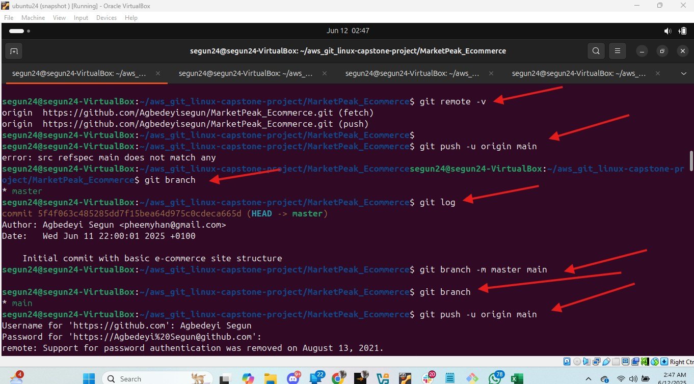

- Step 7

Screenshot of terminal showing the user git setup, views commit history with `git log`, and renames the local branch from `master` to `main` using:
change the branch `git branch -m master main` and push to main with this  `git push -u origin main`

- Step 8

Screenshot of aws console showing login to the user and in ec2 setup page and in United States(N. Virginia) which is "us-east-1" region.
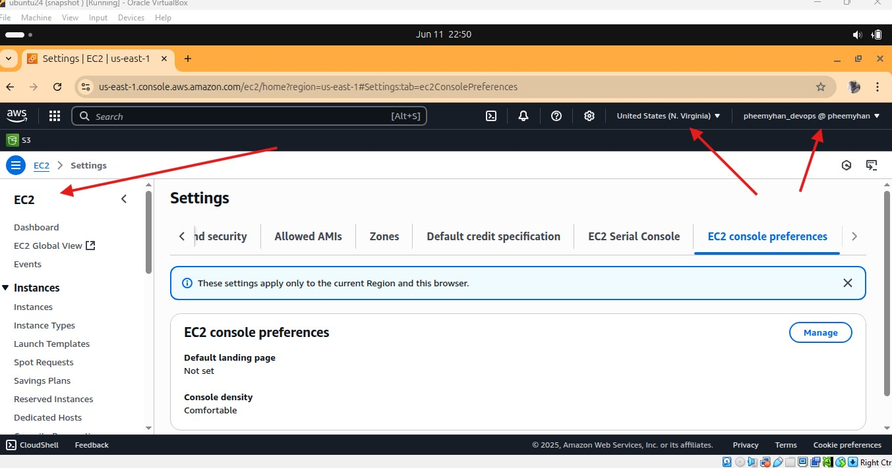

- Step 9

Screenshot of aws console showing ec2 instance setup named "Market Peak Ecommerce" with instance type is t2.micro in United States(N. Virginia) which is "us-east-1" region.
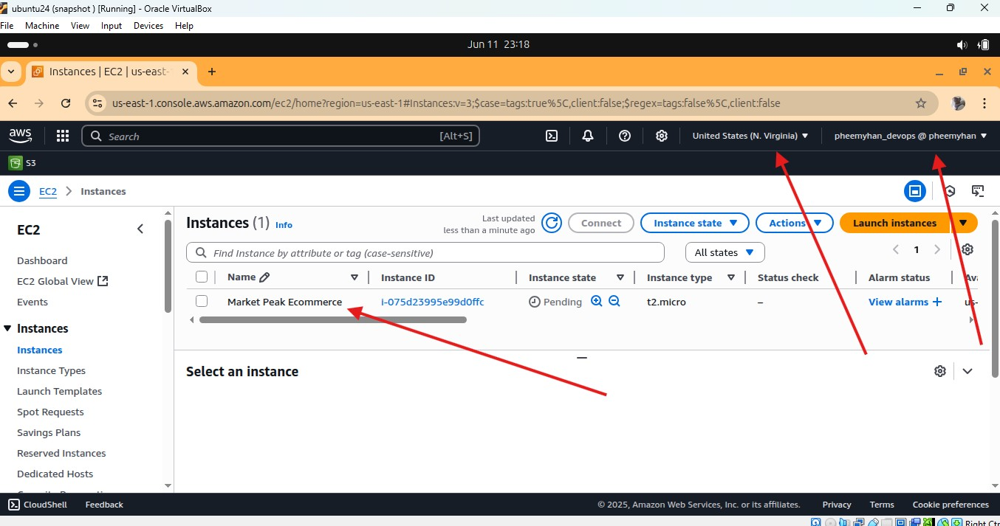

- Step 10

Screenshot of terminal showing the an attempting to connect to an Amazon EC2 instance using SSH with a `.pem` key:
`ssh -i "~/bloomy.pem" ec2-user@ec2-52-71-118-191.compute-1.amazonaws.com`
An initial warning appears about the authenticity of the host and an unprotected private key file. The system rejects the SSH attempt due to insecure permissions (0664) on the .pem file.
I resolves this by updating the permissions using:
`sudo chmod 400 ~/bloomy.pem`

- Step 11: 
Generate SSH Key Pair and View Public Key

This step shows how to generate an SSH key pair and view the public key on a Linux terminal.
Generate SSH Key Pair
Run the following command to generate a new SSH key pair:
ssh-keygen
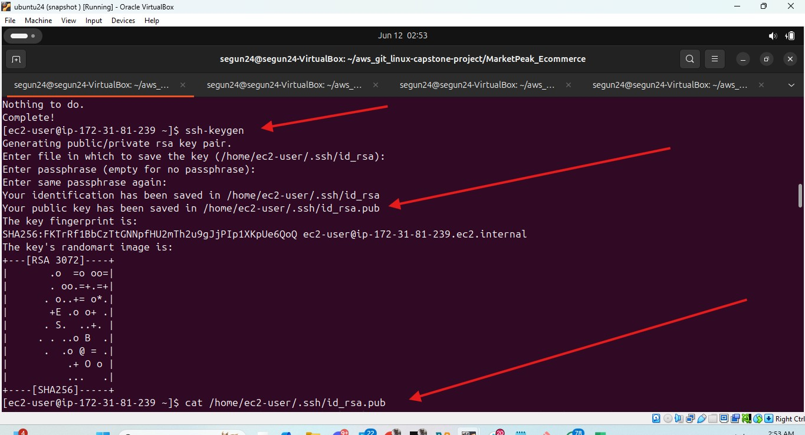

- Step 12: 

Managing GitHub Personal Access Tokens
In this step, accessed GitHub settings to manage **Personal Access Tokens (Classic)**. These tokens are essential for securely interacting with the GitHub API or performing Git operations (like `git push` or `git clone`) when 2FA is enabled or when password authentication is no longer supported.

Navigated to: **https://github.com/settings/tokens**  
- Clicked on the **"Tokens (classic)"** section under "Personal access tokens".
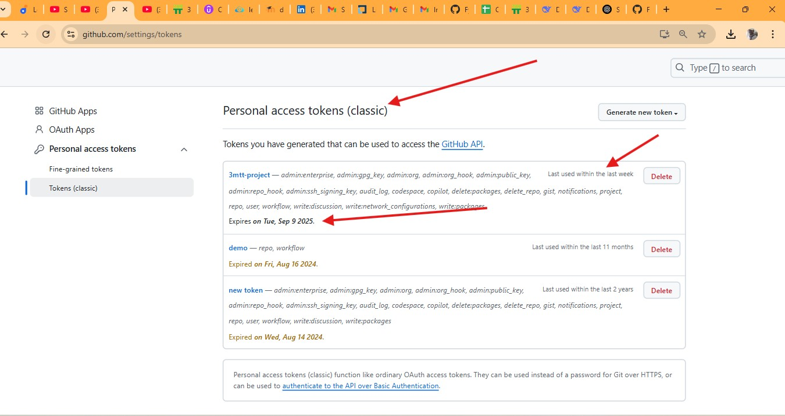

- Step 13: 

Configuring GitHub Repository for E-Commerce Project
In this step, we set up our GitHub repository to host the MarketPeak E-commerce project code. This creates our central version control hub for collaboration and deployment.

Here's what we configured:

- **Repository Name**: `MarketPeak_Ecommerce`
- **Initialized** with blank README.md (to be populated later)
- **Default Branch**: `main`
  git@github.com:[username]/MarketPeak_Ecommerce.git

  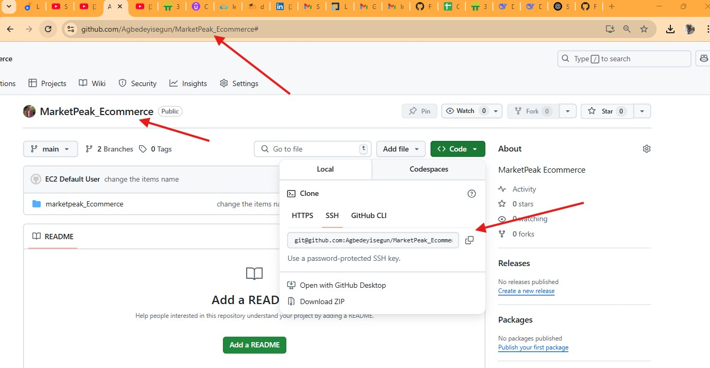

- Step 14: 

System Maintenance on Amazon EC2 Instance

In this step, we performed essential system maintenance on our Amazon Linux 2023 EC2 instance, including authentication and package updates.
**Established Secure Connection**:
   ssh -i "~/bloomy.pem" ec2-user@ec2-52-71-118-191.compute-1.amazonaws.com
 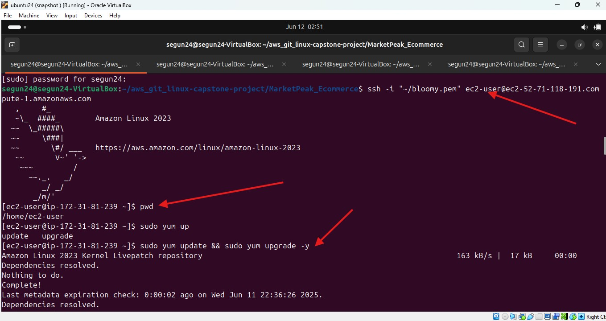

- Step 15

Screenshot of terminal showing the the user trying to connect with the github repo with the local repo by cloning the repo from the remote in to the ec2 instance created on AWS. with `git clone git@github.com:Agbedeyisegun/MarketPeak_Ecommerce.git` before discover that i cant use git cmd without installing git package on the ec2 instance created. `sudo yum install git -y`
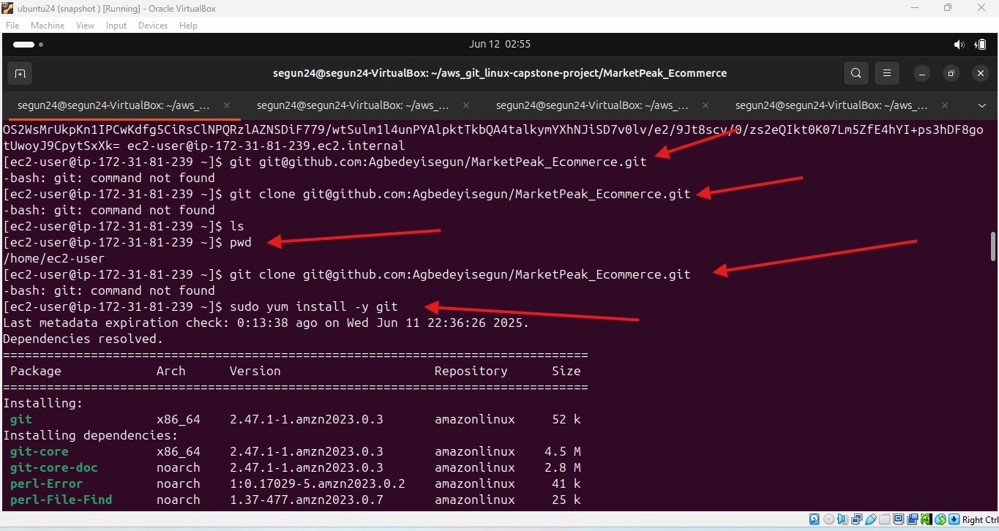

- Step 16

Screenshot of terminal showing the user installing httpd `sudo yum install httpd -y`
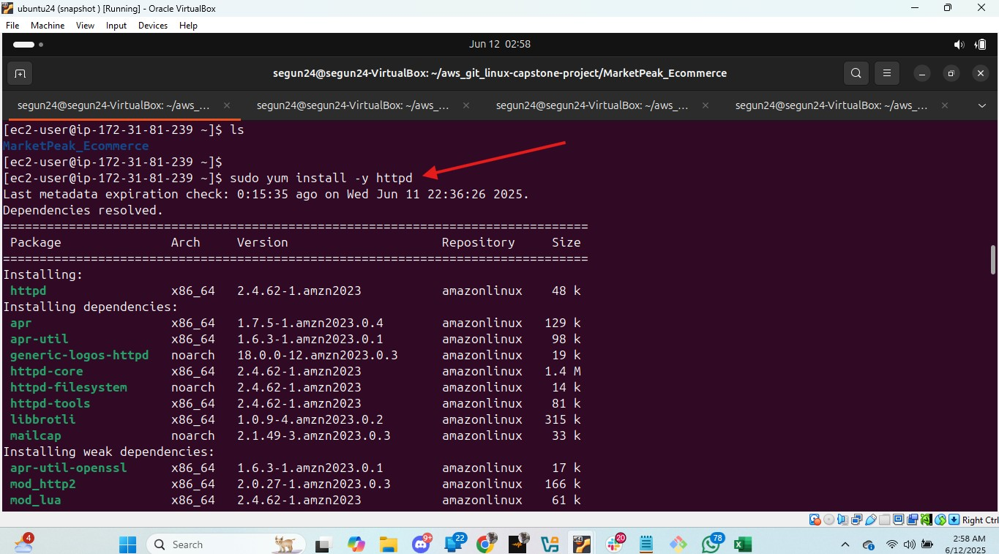

- Step 17

Screenshot of terminal showing the `ls` and `ls -a` cheched the website directory and cp recursively, stat cmd with `cp -r ` and `stat`
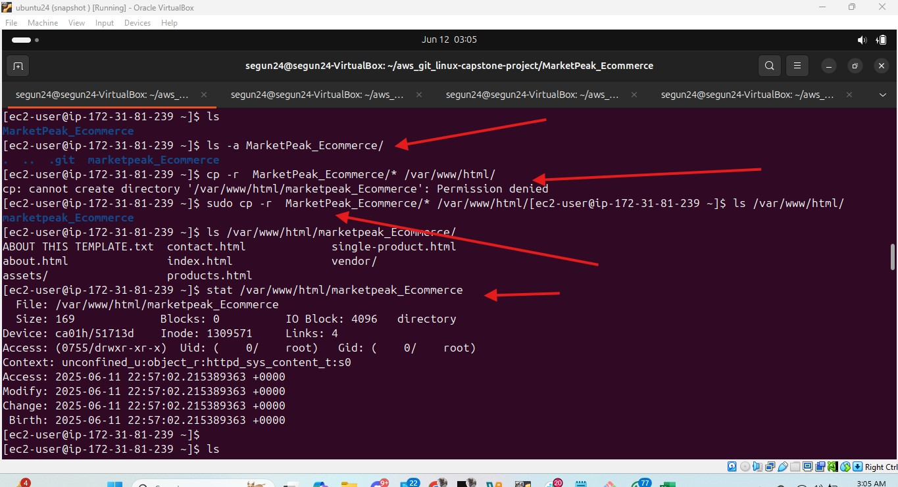

- Step 18

Screenshot of terminal showing the `systemctl enable httpd` and `systemctl status httpd` 
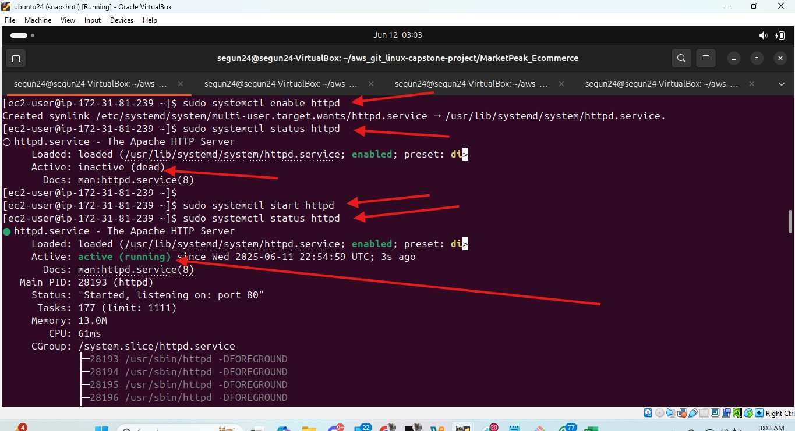

- Step 19

Screenshot of the website on the browser having to use the subdirectory to access it with `52.71.118.191/marketpeak_Ecommerce/index.html` 
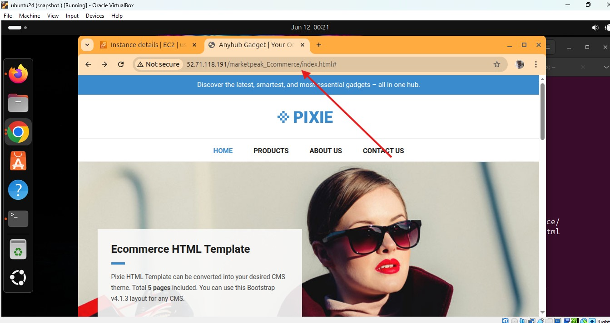

- Step 20

Screenshot showing the website on the browser without index.html now working fine before i making changes to the code `52.71.118.191` 
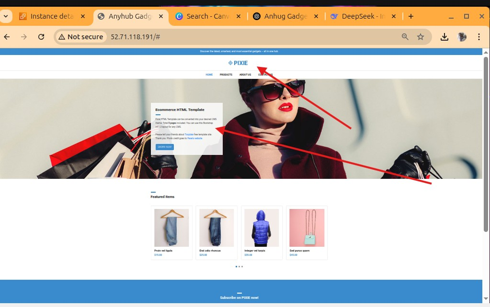

- Step 21

Screenshot of github showing github compare and pull request to absorb the new changes done to the website. Changed the main logo and name of the website from pixie to Anyhub Gadget.
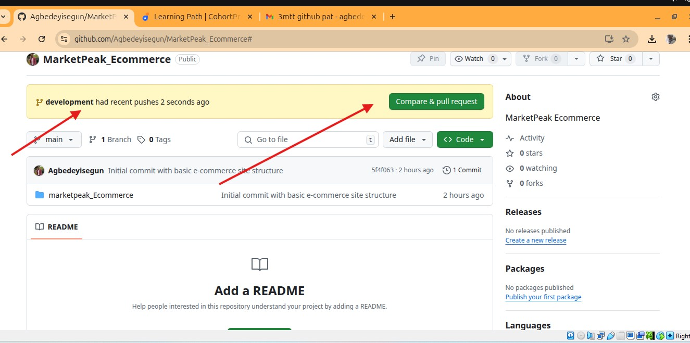

- Step 22

Screenshot of github showing github compare and pull request overview. Changed the main logo and name of the website from pixie to Anyhub Gadget.
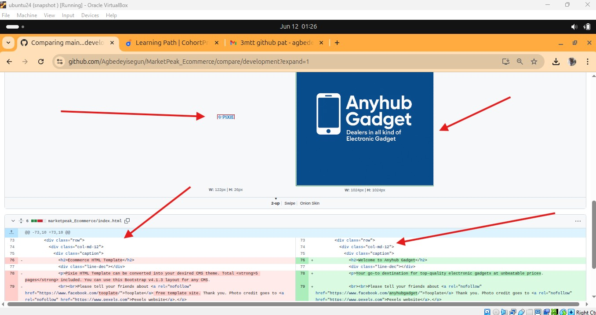

- Step 23

Screenshot of github showing merge pull request, named "fix bug on the front page".
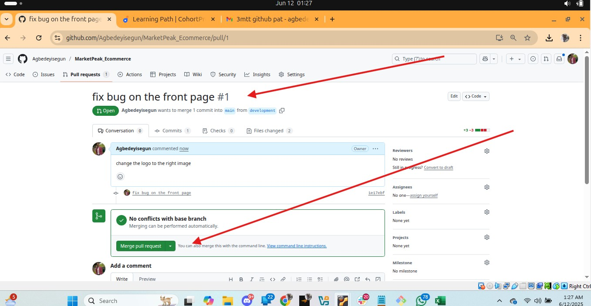

- Step 24

Screenshot of github showing merge pull request. named 'fix bug on the front page' successful merged an closed 
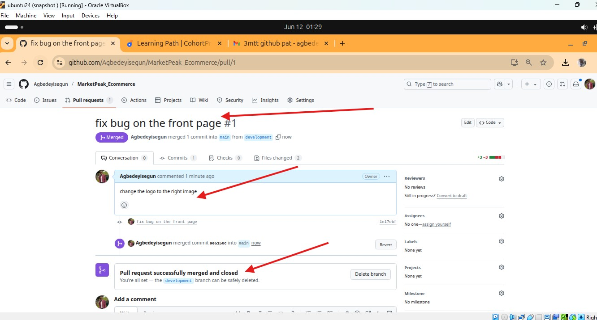

- Step 25

Screenshot of the website showing the new logo and other changes made to the website. 
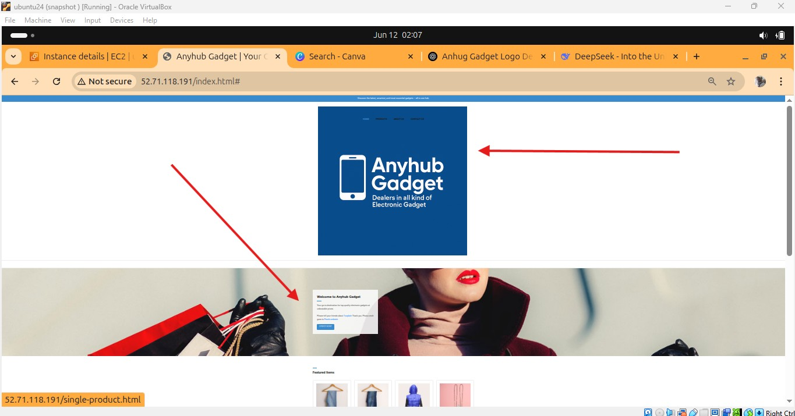

## Issue and debug

I have to change the name of the remote repo to main because when trying to push to main as explained in the module it is showing error and can't push until i change the name from "master" to "main" for it to sync right.